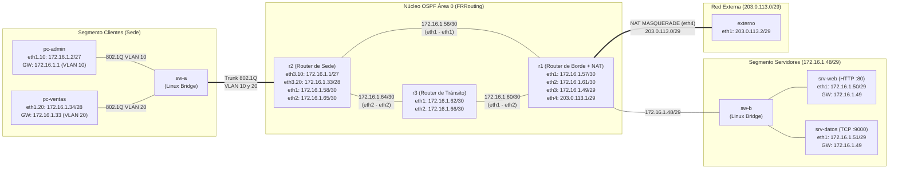

# Diagrama de Topología L2/L3 — NetLab Monitor (Grupo 1)

## 1. Diagrama de Arquitectura (Mermaid)



---

## 2. Diagrama ASCII Detallado de Interfaces

```text
                                     +-----------------------------------+
                                     |              externo              |
                                     |       eth1: 203.0.113.2/29        |
                                     +-----------------+-----------------+
                                                       |
                                                       | Red Externa: 203.0.113.0/29
                                                       | (NAT MASQUERADE en r1:eth4)
                                                       |
                                     +-----------------+-----------------+
                      +------------- |             r3 (FRR)              | -------------+
                      |              |  eth2: 172.16.1.66/30 (a r2:eth2) |              |
                      |              |  eth1: 172.16.1.62/30 (a r1:eth2) |              |
                      |              +-----------------------------------+              |
    Enlace /30        |                                                                 | Enlace /30
  172.16.1.64/30      |                         OSPF AREA 0                             | 172.16.1.60/30
                      |                                                                 |
+---------------------+-------------+                                     +-------------+---------------------+
|             r2 (FRR)              |      Enlace /30: 172.16.1.56/30     |          r1 (FRR + NAT)           |
|      eth2: 172.16.1.65/30         |-------------------------------------|      eth1: 172.16.1.57/30         |
|      eth1: 172.16.1.58/30         |           (eth1 <---> eth1)         |      eth2: 172.16.1.61/30         |
|   eth3.10: 172.16.1.1/27 (VLAN10) |                                     |      eth3: 172.16.1.49/29 (Srv)   |
|   eth3.20: 172.16.1.33/28(VLAN20) |                                     |      eth4: 203.0.113.1/29 (Ext)   |
+-----------------+-----------------+                                     +-----------------+-----------------+
                  |                                                                         |
                  | Trunk 802.1Q (eth3)                                                     | LAN Servidores (eth3)
                  |                                                                         | 172.16.1.48/29
        +---------+---------+                                                     +---------+---------+
        |   sw-a (Bridge)   |                                                     |   sw-b (Bridge)   |
        +---+-----------+---+                                                     +---+-----------+---+
            |           |                                                             |           |
   VLAN 10  |           | VLAN 20                                                     |           |
+-----------+---+   +---+-----------+                                     +-----------+---+   +---+-----------+
|   pc-admin    |   |   pc-ventas   |                                     |    srv-web    |   |   srv-datos   |
|   eth1.10:    |   |   eth1.20:    |                                     |     eth1:     |   |     eth1:     |
| 172.16.1.2/27 |   |172.16.1.34/28 |                                     |172.16.1.50/29 |   |172.16.1.51/29 |
| GW:172.16.1.1 |   |GW:172.16.1.33 |                                     |  HTTP (:80)   |   |  TCP (:9000)  |
+---------------+   +---------------+                                     +---------------+   +---------------+
```
